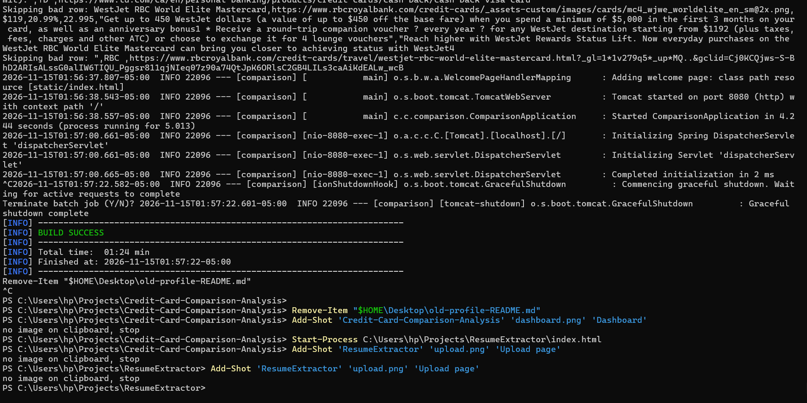

# Resume Extractor

A web app for uploading resumes and turning them into structured, formatted Word documents. The browser page sends each resume to an [n8n](https://n8n.io) workflow through a webhook, and a local Python backend handles the Word-template output.




## What it does

- Upload a resume as `.pdf`, `.doc`, `.docx` or `.txt` from the browser.
- The file is posted to an n8n webhook as `multipart/form-data` (field name `file`).
- The n8n workflow extracts the candidate details, and the result is shown on a results page.
- The Python backend fills Word templates to produce a formatted document (the `tools/` folder has helpers for inspecting and comparing templates).

## How it fits together

| Part | Files | Role |
|---|---|---|
| Frontend | `index.html`, `result.html`, `script.js`, `result.js`, `styles.css` | Upload form and results page |
| HTTPS server | `https_server.py` | Serves the frontend at `https://127.0.0.1:8443` |
| Backend | `backend_server.py` | Local API at `http://127.0.0.1:8444` for Word output |
| Tools | `tools/` | Template inspection and comparison scripts |
| Workflow | n8n webhook | Receives the uploaded resume (not stored in this repo) |

## Getting started

Requires Python 3.9 or newer.

```bash
git clone https://github.com/bhavyapatel0201/ResumeExtractor.git
cd ResumeExtractor
pip install -r requirements.txt
```

The HTTPS server needs a local certificate. Generate a self-signed one (it is git-ignored and must not be committed):

```bash
openssl req -x509 -newkey rsa:2048 -nodes -keyout key.pem -out cert.pem -days 365 -subj "/CN=127.0.0.1"
```

Start both servers. On Windows, run `start-servers.bat`. On any system:

```bash
python https_server.py
python backend_server.py   # in a second terminal
```

Open `https://127.0.0.1:8443`. Your browser will warn about the self-signed certificate; continue past it for local use.

## Using it

1. Paste your n8n Webhook URL into the page.
2. Choose a resume file.
3. Click **Upload**.

## n8n setup

- Use a Webhook node with method `POST`.
- The uploaded file arrives under `binary.file`.
- When opening the page from `file://`, enable Webhook Response and allow CORS.

## More docs

Setup notes and system guides are in [`docs/`](docs/).

## Author

**Bhavya Patel**, Master of Applied Computing, University of Windsor
[LinkedIn](https://linkedin.com/in/bhavya-patel-data) · [Portfolio](https://bhavyapatel0201.github.io)

## Credits

Built with <who and for what>.
